<div align="center">

# Lug'at — English ⇄ Uzbek Dictionary

**An offline English–Uzbek dictionary for Android with pronunciation, flashcards and quizzes.**

Inglizcha–o'zbekcha offlayn lug'at: talaffuz, flashcard va testlar bilan.


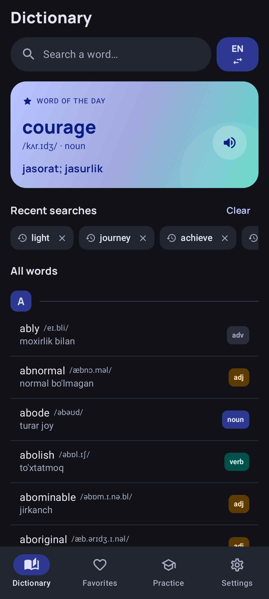
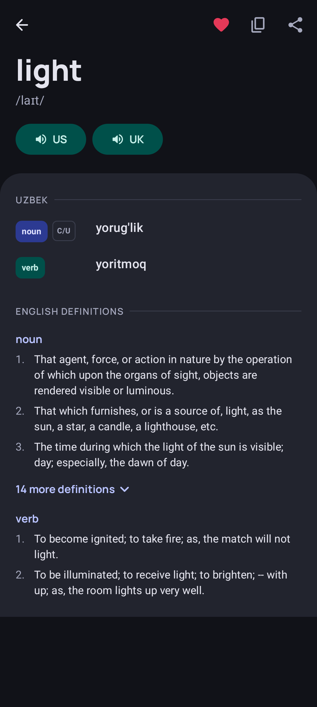
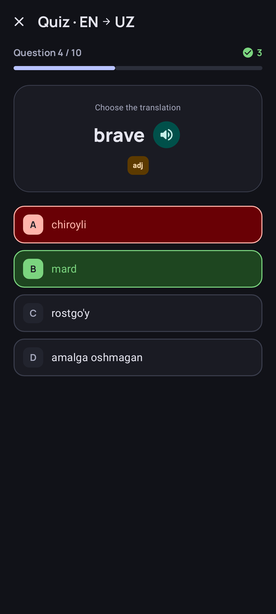

</div>

---

## Features

| | |
|---|---|
| **12,600+ words** | English words with IPA transcription, part of speech and Uzbek translations |
| **50,000+ definitions** | English definitions from Webster's dictionary, grouped by part of speech |
| **Two-way search** | EN → UZ and UZ → EN, live results with the matching part highlighted |
| **All words list** | The full dictionary, A–Z with letter headers, loaded page by page with Room Paging |
| **Pronunciation** | US and UK accents with adjustable speech rate, using the phone's TextToSpeech engine |
| **Favorites** | Save words, search and sort them, swipe to delete with undo |
| **Flashcards** | 3D flip cards; swipe right for "I know", left for "Repeat" |
| **Quiz** | 10 questions with 4 options each, EN → UZ or UZ → EN, results and statistics |
| **Word of the day** | A new word every day on the home screen |
| **Two UI languages** | English and O'zbekcha, switchable in Settings |
| **Dark & light themes** | Hand-tuned brand palette, dark by default |
| **100% offline** | No internet connection or account needed |

## Screenshots

### Dictionary

<table>
  <tr>
    <td align="center"><br/><sub>Home: word of the day, history, all words</sub></td>
    <td align="center">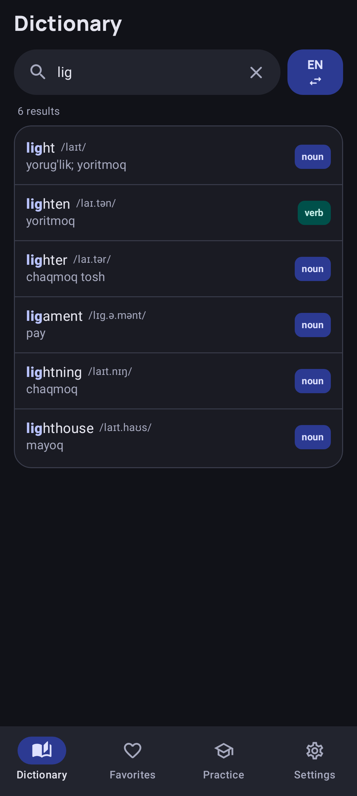<br/><sub>Live search</sub></td>
    <td align="center">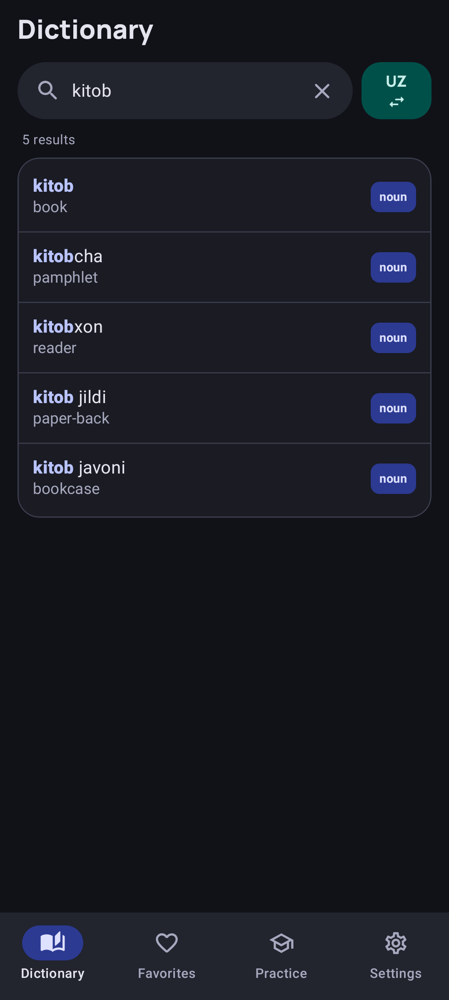<br/><sub>Reverse search UZ → EN</sub></td>
  </tr>
  <tr>
    <td align="center"><br/><sub>Word detail</sub></td>
    <td align="center">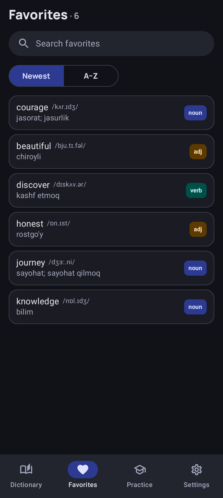<br/><sub>Favorites</sub></td>
    <td align="center">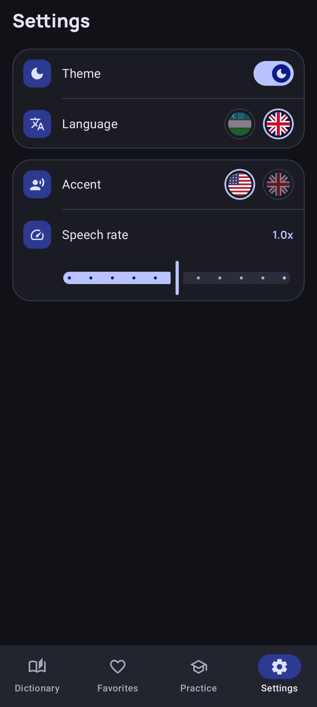<br/><sub>Settings</sub></td>
  </tr>
</table>

### Practice

<table>
  <tr>
    <td align="center">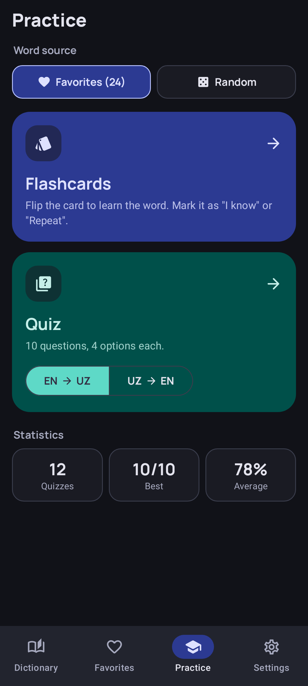<br/><sub>Practice hub</sub></td>
    <td align="center">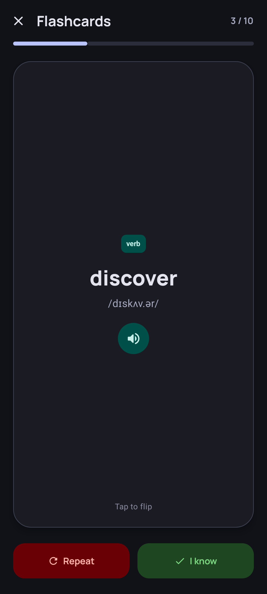<br/><sub>Flashcards</sub></td>
    <td align="center"><br/><sub>Quiz</sub></td>
    <td align="center">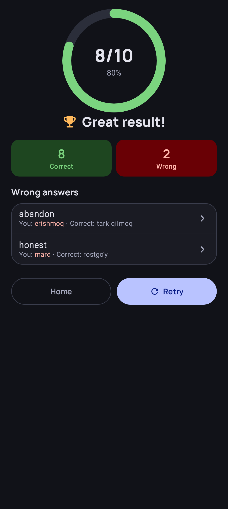<br/><sub>Quiz result</sub></td>
  </tr>
</table>

### Light theme

<table>
  <tr>
    <td align="center">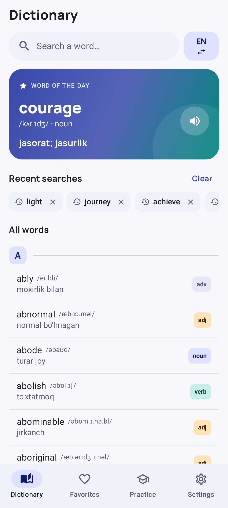</td>
    <td align="center">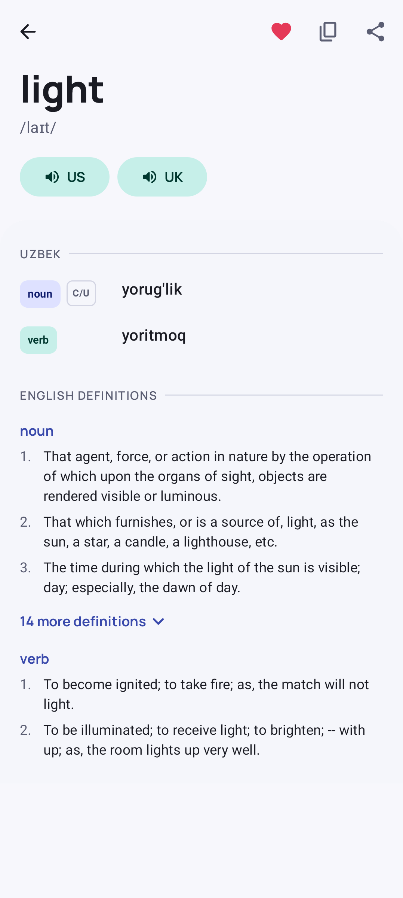</td>
  </tr>
</table>

## Tech stack

| Layer | Libraries |
|---|---|
| UI | Jetpack Compose, Material 3, Material Icons, Manrope font |
| Architecture | MVI with [Orbit MVI](https://github.com/orbit-mvi/orbit-mvi), Clean Architecture (data / domain / presenter) |
| Navigation | [Voyager](https://github.com/adrielcafe/voyager): navigator, tab navigator, transitions, Hilt integration |
| DI | Hilt |
| Data | Room (pre-populated asset DB plus a user DB), Room Paging, SharedPreferences |
| Other | Android TextToSpeech, SplashScreen API, edge-to-edge |

## Architecture

```
uz.gita.dictionaryapp
├── app/            DictionaryApp (@HiltAndroidApp)
├── data/
│   ├── mapper/             Entity → domain model
│   ├── repository_impl/    Repository implementations
│   ├── source/local/
│   │   ├── dictionary/     Read-only Room DB, copied from assets
│   │   └── user/           Favorites, history and quiz results (separate DB)
│   ├── storage/            SettingsManager (SharedPreferences)
│   └── tts/                SpeechManager (TextToSpeech)
├── domain/
│   ├── model/              WordItem, WordDetail, QuizQuestion, …
│   ├── repository/         Repository interfaces
│   └── usecase/            One interface per use case, with impl/
├── di/                     Hilt modules
├── navigation/             AppNavigator → SharedFlow → Voyager Navigator
└── presenter/
    ├── screen/<feature>/   Contract · ViewModel · Screen · Directions
    └── ui/                 Theme and shared components
```

Each screen follows the same contract:

```kotlin
interface SearchContract {
    interface ViewModel : OrbitContainerHost<UiState, UiState, SideEffect> {
        fun onEventDispatcher(intent: Intent)
    }
    sealed interface Intent { … }       // user actions
    sealed interface SideEffect { … }   // one-off events (snackbar, share, …)
    data class UiState(…)               // everything the screen renders
    interface Directions { … }          // navigation, implemented through AppNavigator
}
```

The dictionary data and the user's data live in **two separate databases**. When the dictionary is updated, only the read-only DB is replaced, so favorites and history stay intact.

## Dictionary data

The asset database `app/src/main/assets/database/dictionary.db` (≈7 MB) is generated by a script from two sources:

```bash
python3 tools/build_dictionary_db.py ~/path/to/source-dbs
```

The script:
- normalizes the text: trims spaces, removes trailing commas, and unifies countable labels such as `[ C  or  U ]` → `C/U`;
- maps Webster part-of-speech abbreviations (`n.`, `v. t.`, `a.`, …) to `noun`, `verb`, `adj`, …;
- keeps only the definitions for words that exist in the dictionary;
- writes a schema that matches the Room entities exactly.

> When the schema or the data changes, bump `DB_VERSION` in the script **and** `version` in `DictionaryDatabase` together.

## Build

Requirements: Android Studio (AGP 9.4), JDK 17+, Android SDK 37.

```bash
# Debug
./gradlew :app:assembleDebug

# Signed release (needs keystore.properties, see below)
./gradlew :app:assembleRelease
```

### Release signing

Release builds read their signing config from `keystore.properties` in the project root. Both this file and the `keystore/` folder are in `.gitignore`.

```properties
storeFile=keystore/dictionary-release.jks
storePassword=…
keyAlias=dictionary
keyPassword=…
```

If the file is missing, the release build is produced **unsigned**.

### Regenerating screenshots

The screenshots in this README are rendered from the real Compose screens with Robolectric and Roborazzi:

```bash
./gradlew :app:recordRoborazziDebug
# → docs/screenshots/*.png
```

The sample screen states are defined in `app/src/test/java/uz/gita/dictionaryapp/screenshots/ReadmeScreenshots.kt`.

## Roadmap

- [ ] Real privacy policy and Play Store listing
- [ ] Baseline profile for faster startup
- [ ] Adaptive layout for tablets and foldables (list–detail)

---

<div align="center">
<sub>Made with Kotlin & Jetpack Compose in Uzbekistan</sub>
</div>
